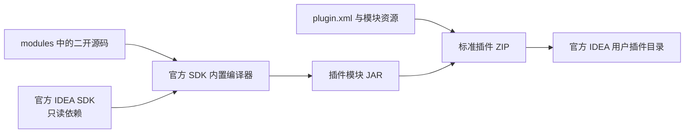

# Bookmarks 源码入口

## 1. 常用修改位置

下面列出独立桌面模块的主要业务入口。

| 需求 | 文件 |
|---|---|
| 书签管理、列表、默认分组、助记符分配 | `modules/core/src/com/intellij/ide/bookmark/BookmarksManagerImpl.kt` |
| 树形分组创建、迁移、移动、循环检测 | `modules/core/src/com/intellij/ide/bookmark/BookmarksManagerImpl.kt` |
| 版本、独立书签表、分组树和引用 | `modules/core/src/com/intellij/ide/bookmark/state.kt` |
| 归一化、格式校验与旧状态备份 | `modules/core/src/com/intellij/ide/bookmark/BookmarkStorageFormat.kt` |
| 原版分支上下文协议的升级适配器 | `modules/core/src/com/intellij/ide/bookmark/context/BookmarkContextProvider.kt` |
| 行编辑、文件变化、书签位置跟踪 | `modules/core/src/com/intellij/ide/bookmark/providers/LineBookmarkProvider.kt` |
| 文件和行书签对象 | `modules/core/src/com/intellij/ide/bookmark/providers/` |
| 编辑器侧栏书签绘制与刷新 | `GutterLineBookmarkRenderer.kt`、`GutterLineBookmarkUpdater.kt`，位于核心 `bookmark` 包 |
| 添加、删除、分组和导航动作 | `modules/core/src/com/intellij/ide/bookmark/actions/` |
| 多组归属的独立复选树与对话框 | `modules/core/src/com/intellij/ide/bookmark/ui/BookmarkGroupsDialog.kt` |
| 按引用数量选择删除范围 | `modules/core/src/com/intellij/ide/bookmark/ui/BookmarkDeletion.kt` |
| 原生 Markdown 编辑页、内存文档和描述回写 | `modules/core/src/com/intellij/ide/bookmark/ui/MarkdownDescriptionEditor.kt` |
| 描述的只读预览和树节点摘要 | `MarkdownDescriptionPanel.kt`、`MarkdownPane.kt`、`MarkdownDescriptions.kt` |
| 子分组与分组移动动作 | `modules/core/src/com/intellij/ide/bookmark/actions/GroupHierarchyActions.kt` |
| 父分组选择器 | `modules/core/src/com/intellij/ide/bookmark/ui/GroupParentDialog.kt` |
| 任意深度的树与节点定位 | `ui/tree/RootNode.kt`、`ui/tree/GroupNode.kt`、`ui/GroupBookmarkVisitor.kt` |
| 工具窗口、弹窗和树节点 | `modules/core/src/com/intellij/ide/bookmark/ui/` |
| 服务、工具窗口、Action 注册 | `modules/core/resources/intellij.platform.bookmarks.xml` |
| 调试断点列表 | `modules/debugger/src/com/intellij/platform/debugger/impl/bookmarks/BreakpointListProvider.kt` |
| VCS Log 适配 | `modules/vcs/src/com/intellij/platform/vcs/log/impl/bookmarks/VcsLogBookmarkProvider.kt` |
| 插件元信息和兼容范围 | `plugin/plugin.xml` |

## 2. 原始源码与 SDK 合同

以下源码随工程提供，其中平台 API 和桥接在运行时由官方 IDEA 提供。

| 原始路径 | 作用 | 本次构建处理 |
|---|---|---|
| `official/platform/lang-api/src/com/intellij/ide/bookmark/` | Bookmark、BookmarksManager、BookmarkGroup 等接口 | 使用目标 SDK 的接口类，源码用于阅读 |
| `official/platform/lang-api/resources/messages/BookmarkBundle.properties` | 本地化文本 | 使用目标 SDK 资源 |
| `official/platform/favoritesTreeView/` | Favorites URL 桥接 | 使用目标 SDK |
| `official/java/java-bookmarks/` | Java 包书签 | 使用目标 SDK 的 Java 插件模块 |
| `official/platform/tasks-platform-impl/tasks.impl.bookmarks/` | 任务与分支上下文 | 原分支监听器和归档使用 SDK；书签适配器由本插件升级 |
| `official/platform/platform-tests/testSrc/com/intellij/ide/` | 官方书签回归测试 | 保留原始测试，未把整个平台测试框架抽成此工程的运行依赖 |
| `official/platform/bookmarks/backend/`、`frontend/` | 远程开发公开实现 | 保留，桌面 ZIP 不编译 |
| `official/platform/platform-resources/src/keymaps/` | 默认键位绑定 | 官方 IDEA 已注册，沿用相同 Action ID |

当前插件沿用平台公开 API，因而可以与官方 IDEA 的 Java、调试器、VCS 和任务模块衔接。新增功能优先在插件自己的实现和资源中扩展；若要改变平台已有 API 的方法签名，需要另行设计兼容接口。

## 3. Markdown 与分组的依赖

原生 Markdown 编辑通过平台公开的 `FileEditorManager.openFile()` 打开 `LightVirtualFile`，文件类型直接引用官方 Markdown 插件的 `MarkdownFileType`。编辑器、实时预览、语言能力和生命周期由 IDEA 的文件编辑器提供器管理，插件不复制 Markdown 编辑器实现。描述文档监听器即时回写 `BookmarkGroup`；同一个书签在各组共用一个文档与编辑页。关闭页签移除监听器，最后一个引用被删除后关闭编辑页。

`plugin/plugin.xml` 和核心模块声明对 `org.intellij.plugins.markdown` 的依赖。构建 classpath 只引用官方 `plugins/markdown/lib/intellij.markdown.jar`，不将其装进交付 ZIP。工具窗口中的只读预览使用 SDK 的 Markdown 解析库和 Jsoup。

树形分组只扩展实现层和序列化状态，平台 `BookmarkGroup` 接口保持兼容。`getGroups()` 为旧调用者提供前序扁平视图；插件自己的树与分组选择器使用稳定 ID、父子关系和完整显示路径，避免不同分支同名时选错组。

## 4. 构建数据流

本地构建只编译插件模块，并把产物放入标准插件 ZIP。

## 5. 多组引用与共享描述

`InManagerInfo` 为同一书签保存一个描述、助记符和行标记；多个组引用它。`setBookmarkGroups()` 先添加新引用，再移除取消的引用，避免换组时丢失描述与标记。格式 2 在顶层独立保存书签记录和描述，各组只保存书签 ID 引用。旧版存在不同组描述时，保留各段原文及原分组标题后合并；再次保存恢复不重复合并。

`BookmarkDeletion.needsChoice()` 判断是否存在多组引用。工具窗口删除和编辑器 Toggle Bookmark 共用删除范围提示；`deleteOccurrences()` 执行当前组移除或所有组删除。组本身的删除仍保留其他组中的引用。

## 6. 新存储和 AI 入口

当前项目存储迁到 `.idea/bookmarks.xml`，原 `PRODUCT_WORKSPACE_FILE` 标记为 deprecated storage。`ManagerState.formatVersion` 区分旧列表与新引用结构；读取新格式时先校验再改变模型，异步恢复按代次取消过期任务。未知 provider 记录保留在状态中。

平台原有的 `BranchContextTracker` 和 `WorkingContextManager` 保持不变。本插件注册同 ID 的新版书签上下文适配器，移除原来会展开树结构的那个适配器，运行中只有一个 `bookmarks` 提供器。旧归档、新归档和原有开关继续使用相同协议。

AI 使用 `tools/bookmarks_store.py` 编辑导出的 JSON，工具负责源版本检查、XML 编码、归档范围、备份及原子替换。完整格式见 [存储说明](STORAGE.md)，操作规范见 [AI 指南](AI_BOOKMARKS.md)。
