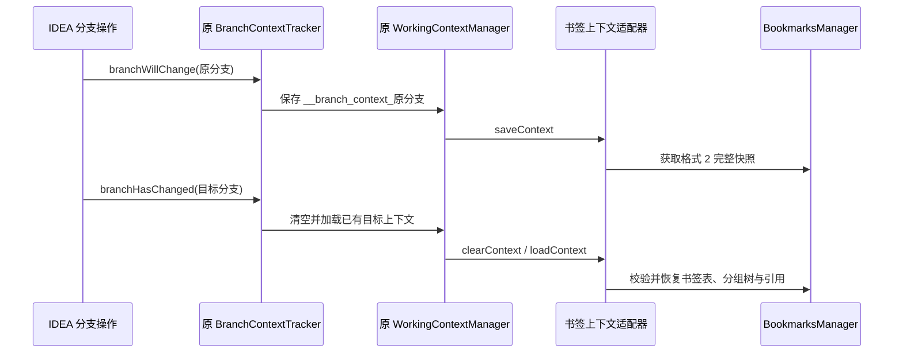

# 书签存储格式与分支上下文

## 1. 设计与范围

从插件 `262.11879.100.4` 开始，当前项目使用 **格式版本 2**：书签独立保存，分组通过 ID 引用书签，Markdown 描述保存在书签记录中。Git 分支切换继续使用 IDEA 原有的任务上下文机制。

这次改造对应以下设计要求。

| 对象 | 保存内容 | 约束 |
|---|---|---|
| 书签 | `id`、`provider`、`attributes`、`type`、`description` | 同一位置保存一条记录；描述只保存一份 |
| 分组 | `id`、`parentId`、`name`、`default`、`bookmarkIds` | 用父 ID 组成树；引用数组决定组内书签顺序 |
| 多组归属 | 各组的 `bookmarkIds` 指向同一个书签 ID | 允许跨组引用；同一组不得重复引用 |
| Git 分支快照 | 一份完整的 `ManagerState` | 使用原有上下文名称、归档与恢复开关 |
| 格式版本 | `formatVersion = 2` | 新格式严格校验；旧格式走兼容迁移 |

描述不再嵌在每个组的书签副本中。书签行号变化时保留书签 ID；分组改名和移动时保留分组 ID。多个组共享当前上下文中的描述；不同 Git 分支快照分别保存自己的描述内容。

## 2. 实际保存位置

目录式 IDEA 项目的当前状态与分支历史使用两个位置。

| 数据 | 位置 | 管理方 |
|---|---|---|
| 当前项目书签 | `<项目目录>/.idea/bookmarks.xml` | IDEA `PersistentStateComponent` |
| 旧状态迁移来源 | 原 `PRODUCT_WORKSPACE_FILE` 中的 `BookmarksManager` | IDEA 的 deprecated storage 迁移 |
| 首份旧数据备份 | `<项目目录>/.idea/bookmarks-legacy-backup.xml` | 插件创建一次，不覆盖 |
| Git 分支上下文归档 | `<IDE配置目录>/tasks/<实际项目归档名>.contexts.zip` | IDEA `WorkingContextManager` |
| AI 工具写入前备份 | 目标文件旁 `bookmarks-backups/` | AI 工具按原文件 SHA-256 保留 |

旧的 `PRODUCT_WORKSPACE_FILE` 不一定是项目内的 `.idea/workspace.xml`。此前 GUI 验收中它位于 IDE 配置目录的 `workspace/<项目ID>.xml`；迁移由平台读取原 storage，AI 不需要猜测该路径。

分支归档名使用 IDEA 的项目名清理规则，不能直接拿项目文件夹名拼接。先枚举实际的 `.contexts.zip`，再用工具查看其中的分支。当前项目文件和分支归档可能保存不同时间点的数据：编辑当前项目文件不会自动重写已经保存的分支历史。

## 3. 新格式

下面是一条书签被父组和子组同时引用的完整示例。行号从 0 开始，示例中的 `0` 对应编辑器第 1 行；ID 为示例值，实际创建时使用 UUID。

```xml
<?xml version="1.0" encoding="UTF-8"?>
<project version="4">
  <component name="BookmarksManager">
    <option name="formatVersion" value="2" />
    <option name="bookmarks">
      <BookmarkState>
        <option name="id" value="bookmark-1" />
        <option name="provider" value="com.intellij.ide.bookmark.providers.LineBookmarkProvider" />
        <option name="type" value="DEFAULT" />
        <option name="description" value="读取入口&#10;&#10;负责读取并提交检查点。" />
        <attributes>
          <entry key="url" value="file://$PROJECT_DIR$/src/Reader.java" />
          <entry key="line" value="0" />
        </attributes>
      </BookmarkState>
    </option>
    <option name="groups">
      <GroupState>
        <option name="id" value="group-root" />
        <option name="name" value="同步链路" />
        <option name="default" value="true" />
        <option name="bookmarkIds"><option value="bookmark-1" /></option>
      </GroupState>
      <GroupState>
        <option name="id" value="group-child" />
        <option name="parentId" value="group-root" />
        <option name="name" value="读取入口" />
        <option name="bookmarkIds"><option value="bookmark-1" /></option>
      </GroupState>
    </option>
  </component>
</project>
```

文件书签通常没有 `line`；无效文件书签也可能以 `-1` 表示整个文件。`lineText` 是可选的行文本锚点，不属于书签身份。相同 provider 和位置应复用已有书签 ID，不能通过修改 `lineText` 制造第二条记录。

`type` 为 `DEFAULT`、`LETTER_A` 至 `LETTER_Z` 或 `DIGIT_0` 至 `DIGIT_9`。非默认助记符在当前快照中唯一。未识别的 provider 记录会保留在存储中，避免暂时缺少适配器时丢失数据。

父组和子组的归属独立，树形层级不隐含书签引用。父组引用一个书签，不等于它的子组也引用该书签。

## 4. 复用原有分支机制

保存和恢复沿用原平台链路，仅书签上下文适配器升级为完整恢复新格式。



适配器继续使用上下文 ID `bookmarks` 和开关 `tasks.enable.bookmark.context.on.branch.switch`。它替换内置的书签适配器，避免原适配器按组名恢复时把树形结构展开；实际只注册一个 `bookmarks` 上下文适配器。插件要求重启后启用，切换监听器、任务管理器、归档格式与上下文名称均由官方 IDEA 提供。

原有行为保留如下。

| 条件 | 行为 |
|---|---|
| 书签上下文开关开启，且 `VcsConfiguration.RELOAD_CONTEXT` 开启 | 切换到已有上下文的分支时恢复其书签 |
| 书签上下文开关关闭 | 书签的上下文保存、清空和加载均不执行，继续使用全局书签 |
| 首次进入尚无上下文的分支 | 原机制不会自动清空当前书签；首次保存后才有该分支快照 |
| 目标分支已属于当前活动任务 | 原任务机制可能接管恢复，原监听器跳过重复恢复 |
| Git 分支改名或删除 | 不由本插件自动重命名、删除历史归档项 |

通过 IDEA 的分支操作使用这条链路。外部终端执行 Git 命令是否产生同样的事件取决于平台集成，本文不承诺额外的命令行切换监听。多个仓库或同名项目的上下文名称与归档归属继续遵循官方机制，未新增仓库级命名空间。

## 5. 迁移、校验与删除

旧状态没有 `formatVersion`，书签保存在 `GroupState.bookmarks` 中。平台先读取旧 storage，插件备份原组件状态，再使用现有迁移逻辑恢复；下次保存写入格式 2。旧分支归档同样可由升级后的适配器读取。旧数据里不同组的不同描述会合并保留原文；一致的描述保持原样。

新格式在清空当前模型之前校验。以下数据会被拒绝：未知版本、重复或空 ID、缺失父组、分组环、同级重名、重复组内引用、悬空引用、无任何组引用的书签、重复位置及助记符冲突。原数据修复逻辑只用于旧格式，新格式不通过静默改名或移到根组来掩盖错误。

删除规则与界面一致：有多个组引用时选择移除当前引用或删除所有引用；只有一个组引用时直接删除。AI 操作数据时，移除最后一个引用必须同时移除书签表中的对应记录；删除一棵分组子树时，只清理失去全部引用的书签。

降级到旧版插件前应保留新文件、原状态备份和上下文归档。旧版适配器不能按新引用结构完整恢复树形分组；卸载用户插件后，内置旧版也不会自动读取新的 `.idea/bookmarks.xml`。

## 6. 源码与验证入口

实现和检查位于以下文件。

| 文件 | 职责 |
|---|---|
| `modules/core/src/com/intellij/ide/bookmark/state.kt` | 版本、书签表、分组表与引用 |
| `modules/core/src/com/intellij/ide/bookmark/BookmarkStorageFormat.kt` | 归一化、解析、严格校验和旧状态备份 |
| `modules/core/src/com/intellij/ide/bookmark/BookmarksManagerImpl.kt` | 稳定 ID、异步恢复、迁移与持久化 |
| `modules/core/src/com/intellij/ide/bookmark/context/BookmarkContextProvider.kt` | 复用原平台上下文协议的升级适配器 |
| `modules/core/src/com/intellij/ide/bookmark/BookmarkWorkspaceStore.kt` | workspace.xml 中的阅读路线和保存视图；阅读状态另随原上下文保存 |
| `modules/core/src/com/intellij/ide/bookmark/BookmarkHealth.kt` | 只读巡检、候选定位及保留稳定 ID 的带备份修复 |
| `tools/bookmarks_store.py` | AI 的 JSON 导出、校验、原子写入和归档编辑 |
| `tests/test_bookmarks_store.py` | 修改范围、并发版本、备份和归档隔离检查 |
| `tests/runtime/BookmarkSmokeStarter.java` | 原版上下文链路及实际 IDE 序列化验证 |

原平台链路见固定上游版本的 [BranchContextTracker](https://github.com/JetBrains/intellij-community/blob/idea/262.11879.100/platform/tasks-platform-impl/src/com/intellij/tasks/context/BranchContextTracker.java)、[WorkingContextManager](https://github.com/JetBrains/intellij-community/blob/idea/262.11879.100/platform/tasks-platform-impl/src/com/intellij/tasks/context/WorkingContextManager.java) 和本工程保留的 [原书签适配器](../official/platform/tasks-platform-impl/tasks.impl.bookmarks/src/BookmarkContextProvider.java)。AI 操作方法见 [AI 整理指南](AI_BOOKMARKS.md)。

从 `.9` 开始，项目个人组件 `BookmarksWorkspace` 在 `workspace.xml` 保存视图条件及阅读路线。启用随分支恢复时，上下文中的 `bookmarks` 元素还会保存 `BookmarkReadingState`，与 `ManagerState` 并列；旧上下文缺少该元素时恢复为空进度。保存视图保持项目范围，不随分支覆盖。上述状态不扩展格式 2、不进入书签 JSON，详细边界见 [工作流说明](WORKFLOWS.md)。
